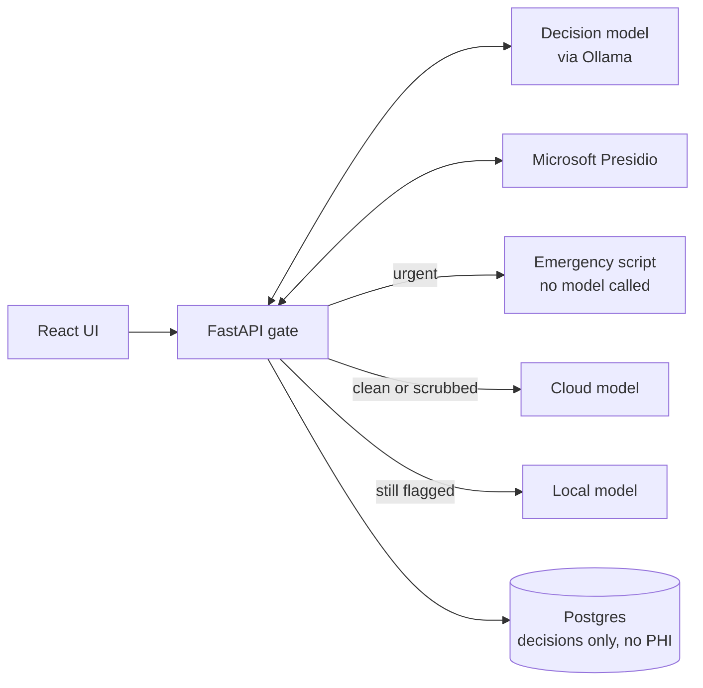

# Judgment Engine: A PHI Gate for Generative AI

A working reference implementation of a **PHI gate**: a local service that judges every message before any language model sees it. It detects protected health information (PHI), scrubs it into typed placeholders like `[NAME]` and `[DATE]`, escalates possible emergencies to people instead of a model, keeps still-risky text on local hardware, and logs every decision **without storing message text**.

It pairs a local **decision model** (a model that returns calibrated probabilities for predefined questions instead of generating text) with **Microsoft Presidio** for deterministic entity detection, and measures how well the combination works with a reproducible evaluation harness.

> **This is a demonstration project, not a compliance product.** It uses only fake data generated with [Faker](https://faker.readthedocs.io/), is not medical advice, and does not by itself make any system HIPAA compliant. Validate any production design with your compliance and legal teams.

## How it works



Every message takes one of four paths:

| Status | When | What leaves the gate |
| --- | --- | --- |
| `escalated` | The message describes a possible emergency | Nothing: a scripted reply directs the user to emergency services |
| `clean` | No identifiers detected | The original message, to the cloud model |
| `scrubbed` | Identifiers found and removed | The scrubbed text, e.g. `Hi, this is [NAME], born [DATE].` |
| `local_only` | Something identifying survived scrubbing | Nothing leaves the machine: a local model answers |

If any part of the gate is unavailable, the API **fails closed**: it returns an error rather than forwarding an unjudged message.

## Design decisions

- **Layered detection, weighted by reliability.** Presidio and the decision model check every message. Strong entities (names, phone numbers, email addresses, SSNs, record numbers) trigger scrubbing on their own; contextual entities (dates, locations) count only when the decision model agrees they're tied to a person. This keeps questions like "What are your clinic hours on Saturday?" from being scrubbed into nonsense.
- **A bounded re-check.** After scrubbing, the text is judged exactly once more, never "until it stabilizes." The re-check tells the model which placeholders the scrubber produced, so `born [DATE]` isn't mistaken for a real birth date. That note applies only to text the gate scrubbed itself, so a user can't hide a real name from the judge by typing it in brackets.
- **Asymmetric safety thresholds.** Missing an emergency is far worse than over-escalating, so emergency detection uses a lower threshold than PHI detection.
- **Decisions are logged; messages are not.** The decision log stores scores, thresholds, routes, and models, never message text, so the audit trail doesn't become a new store of PHI.
- **Measured, not assumed.** A fixed-seed evaluation harness reports recall and precision for the decision model alone, Presidio alone, and both layered together.

## Quick start

### Prerequisites

- [Docker Desktop](https://www.docker.com/products/docker-desktop/)
- [Ollama](https://ollama.com/) 0.35.1 or later, running **natively** on the host (not in Docker), so it can use your GPU directly
- Node.js 20 or later, for the React UI

### 1. Pull the models

```bash
ollama pull tev1:4b            # decision model (judge), ~4.5 GB
ollama pull llama3.2:3b        # local model for the local-only route
ollama signin                  # required for Ollama cloud models
ollama pull glm-5.3-flash:cloud
```

Any decision model that supports Ollama's `/v1/systemone` endpoint works as the judge. On a 12 GB GPU, `tev1:4b` fits alongside the local model; 9B models such as `clef-flash` and `nimble` need more GPU memory (see [Running the judge on a rented GPU](#running-the-judge-on-a-rented-gpu)).

`glm-5.3-flash:cloud` runs on Ollama's servers, which is why only clean or scrubbed text is ever sent to it.

### 2. Configure

```bash
cp .env.example .env
```

Then edit `.env` as needed (see [Configuration](#configuration)). Never commit `.env`.

### 3. Run

```bash
docker compose up -d --build
```

The first start downloads the Presidio images and takes a few minutes. Then:

- **API docs:** http://localhost:8000/docs, an interactive page for sending requests to `/chat`
- **React UI:** `cd web && npm install && npm run dev`, then open http://localhost:5173

### 4. Try each path

| Message | Expected status |
| --- | --- |
| `What are your clinic hours on Saturday?` | `clean` |
| `Hi, this is Maria Gonzalez, born 03/14/1961. Can I refill my asthma inhaler?` | `scrubbed` |
| `My father has crushing chest pain going down his left arm right now.` | `escalated` |

Check the audit trail:

```bash
docker compose exec db psql -U gate -d gate -c "SELECT status, route, model, entity_types, latency_ms FROM decision_log ORDER BY id DESC;"
```

## Tests and evaluation

Unit tests mock every model and service, and assert on **what actually left the gate**, not just the status:

```bash
docker compose exec api python -m pytest -v
```

The evaluation harness generates fake prompts with and without identifiers, then reports recall and precision for each detection strategy:

```bash
docker compose exec api python -m app.evaluate
docker compose exec -e EVAL_THRESHOLD=0.5 api python -m app.evaluate   # threshold sweep
```

## Configuration

| Variable | Purpose | Default |
| --- | --- | --- |
| `OLLAMA_URL` | Ollama for the local and cloud chat models | `http://host.docker.internal:11434` |
| `JUDGE_URL` | Ollama for the decision model, if it runs elsewhere | same as `OLLAMA_URL` |
| `JUDGE_MODEL` | Decision model | `tev1:4b` |
| `LOCAL_MODEL` | Model for still-flagged messages | `llama3.2:3b` |
| `CLOUD_MODEL` | Model for clean or scrubbed messages | `glm-5.3-flash:cloud` |
| `PHI_THRESHOLD` | First-pass identifier threshold | `0.20` |
| `URGENT_THRESHOLD` | Emergency threshold (kept low on purpose) | `0.25` |
| `RECHECK_THRESHOLD` | Identifier threshold after scrubbing | `0.50` |
| `DATABASE_URL` | Postgres connection for the decision log | see `.env.example` |

## Running the judge on a rented GPU

To compare larger decision models without local GPU memory, run only Ollama on a rented GPU (for example, on [Vast.ai](https://vast.ai/)) and keep the rest of the stack local.

1. On the instance, run `scripts/vast-setup.sh`, which installs Ollama, starts it, and pulls `clef-flash` and `nimble`.
2. From your machine, open an SSH tunnel so nothing is exposed publicly:

   ```bash
   ssh -p <PORT> root@<HOST> -L 11435:localhost:11434 -N
   ```

3. Create `.env.vast` as a full copy of `.env` with `JUDGE_URL=http://host.docker.internal:11435` and the model you're testing, then start the API with it:

   ```bash
   API_ENV_FILE=.env.vast docker compose up -d api              # Git Bash / macOS / Linux
   ```

   ```powershell
   $env:API_ENV_FILE = ".env.vast"; docker compose up -d api   # PowerShell
   ```

Use only fake data on rented hardware, and destroy the instance when you're done.

## Early findings

| Test | Result |
| --- | --- |
| Emergency message, 0.8B judge | Emergency probability 0.48: below threshold, not escalated |
| Emergency message, 4B judge | Emergency probability 0.99: escalated in 567 ms, no answer model called |
| Re-check without placeholder note | Direct identifiers 0.40, dates 0.70 on already-scrubbed text |
| Re-check with placeholder note | Direct identifiers 0.06, dates 0.25 |
| Unlabeled ID number missed by Presidio | Caught on re-check (record numbers 0.70); message kept local |

Full evaluation results across model sizes: *[add your recall, precision, and latency table here]*

## Project structure

```text
judgment-engine/
├── compose.yaml
├── .env.example
├── api/
│   ├── Dockerfile
│   ├── requirements.txt
│   ├── app/
│   │   ├── config.py      # settings from the environment
│   │   ├── judge.py       # decision model questions and client
│   │   ├── scrub.py       # Presidio analysis and typed placeholders
│   │   ├── llm.py         # local and cloud chat models
│   │   ├── gate.py        # the gate: detection, scrubbing, routing
│   │   ├── db.py          # decision log (no message text)
│   │   ├── main.py        # FastAPI app
│   │   └── evaluate.py    # Faker-based evaluation harness
│   └── tests/
│       └── test_gate.py
├── scripts/
│   └── vast-setup.sh
└── web/                   # React UI showing each decision
```

## Roadmap

- [ ] Deterministic emergency patterns as a backstop to the model
- [ ] Separate emergency recall in the evaluation, targeting ~100%
- [ ] Labeled ID-number recognizer for Presidio
- [ ] Drift monitoring: score distributions, a scheduled synthetic evaluation, and model versions on every decision
- [ ] User feedback (thumbs up/down) tracked by route
- [ ] LangGraph version of the gate, with self-hosted Langfuse tracing

## Model licenses

Check each model's license before any commercial use. `clef-flash` and `nimble` are Apache 2.0; Nimble v3 is licensed for noncommercial use only. Confirm the license of Tev1's weights before commercial use.

## Author

**Eric Smallwood**, AI Architect, Healthcare AI & Governance
[LinkedIn](https://linkedin.com/in/eric-allen-smallwood) · Article: *[link to "Beyond Chatbots: A Local Judgment Engine for PHI Gating"]*

## License

*[Choose a license, for example MIT, and add a LICENSE file.]*
